# 7didan Knowledge Base — Orange Maroc Business AI Assistant

*7didan* is the RAG (Retrieval-Augmented Generation) backend for the **Orange Maroc Business**
chatbot. It answers questions about Orange Business products/services from a private
knowledge base, and it turns qualified conversations into **leads in Odoo CRM** through an
**n8n webhook**.

> Salut Yassir & Amal 👋 — ce dépôt contient **tout le cerveau du chatbot** : la base de
> connaissances vectorielle (PostgreSQL + pgvector) et l'API FastAPI qui sert le chat et
> envoie les leads au CRM. Les diagrammes dans [`images/`](images/) expliquent
> l'architecture visuellement.

---

## 🗺️ Visual overview (diagrams)

The diagrams below are embedded directly from [`images/`](images/) as **dynamic SVGs** —
they animate (flowing edges/dots) and automatically switch between **dark and light** to
match your OS/GitHub theme. The `.svg` files are self-contained; the `.html` versions are
the full interactive viewers (theme toggle, zoom, search, export) — open them in a
browser for the complete experience. The `.json` files are the machine-readable specs the
diagrams were generated from.

### 🏗️ Runtime architecture



All real components and how they are wired: website → FastAPI → guardrail → pgvector →
reranker → LLM → evaluator, plus the CRM path (API → n8n → Odoo) and the ingestion
pipeline, grouped by Docker container.
Interactive viewer: [`7didan-runtime-architecture.html`](images/7didan-runtime-architecture.html) · spec: [`7didan-runtime-architecture.json`](images/7didan-runtime-architecture.json)

### 💬 Chat request sequence


Step-by-step execution of one `POST /api/chat`: guardrail → embed + search (k=20) →
rerank (top 10) → LLM answer → sources with URLs back to the browser.
Interactive viewer: [`7didan-chat-request-sequence.html`](images/7didan-chat-request-sequence.html) · spec: [`7didan-chat-request-sequence.json`](images/7didan-chat-request-sequence.json)

### 📊 Data flow


How data moves through the 5 stages (Sources → Ingest → Store → Runtime RAG → CRM):
web/PDF → markdown → chunks with `url` metadata → pgvector; chat traffic; enquiry →
scoring → webhook → Odoo; DB export/restore.
Interactive viewer: [`7didan-data-flow.html`](images/7didan-data-flow.html) · spec: [`7didan-data-flow.json`](images/7didan-data-flow.json)

---

## 🧠 What this project does

1. **Ingestion (offline)** — `knowledge_base/` crawls web pages and parses PDFs, cleans the
   text, splits it into chunks, embeds them (Qwen3-Embedding-0.6B) and stores them in
   PostgreSQL/pgvector. Every chunk keeps its **source URL** in its metadata, so the
   chatbot can always show where an answer came from.
2. **Serving (online)** — `retrieval_service/` is a FastAPI app. `/api/chat` runs a guarded
   RAG pipeline: input guardrail → vector search (top 20) → Qwen reranker (top 10) → LLM
   answer with citations → optional quality evaluation. Responses include a `sources`
   array with `title`, `section` and `url`.
3. **CRM funnel** — when a visitor fills the enquiry form, `/api/enquiries` computes a
   `lead_score`, builds a conversation summary, and submits the lead to **n8n**
   (`N8N_WEBHOOK_URL`, authenticated with the `X-7didan-Token` header), which writes it
   into **Odoo** (`crm.lead`). Funnel events are also logged locally in
   `reporting.conversation_events`.

---

## 📁 Repository layout

```
7didan_knowledge base/
├── docker-compose.yml          # db (pgvector) + api services
├── Dockerfile                  # api image (uvicorn on :8000)
├── .env.docker                 # environment for Docker (copy & edit!)
├── requirements.txt            # local dev dependencies
├── requirements-docker.txt     # dependencies baked into the Docker image
├── knowledge_base/             # OFFLINE ingestion pipeline
│   ├── main.py                 #   entry point: crawl/parse → clean → chunk → embed → index
│   └── src/
│       ├── ingestions/         #   crawler (crawl4ai) + PDF parser (docling)
│       ├── preprocessing/      #   cleaner (keeps source_url from sidecar .json)
│       ├── chunkers/           #   MarkdownChunker
│       ├── embedders/          #   QwenEmbedder
│       ├── indexers/           #   PGIndexer (writes "url" into vector metadata)
│       ├── config/             #   crawler.json (URL list), parser.json, model.json
│       └── scripts/            #   backfill_metadata.py (adds url to old rows)
├── retrieval_service/          # ONLINE API
│   └── src/
│       ├── api/main.py         #   FastAPI app: /api/chat, /api/enquiries, /api/events, ...
│       ├── api/schemas.py      #   request/response models
│       ├── chains/rag_chain.py #   lazy-built guarded RAG chain
│       ├── guardrails/         #   LLM-based input guardrail
│       ├── retrieval/          #   PGRetriever (pgvector similarity search)
│       ├── reranking/          #   Qwen cross-encoder reranker
│       ├── evaluators/         #   answer-quality evaluator
│       └── crm/                #   client.py (n8n webhook), scoring.py, events.py
├── postgres/
│   ├── 7didan_backup.sql       # plain-SQL dump auto-restored into fresh DB volumes
│   └── README.md
├── scripts/export_db.py        # regenerate postgres/7didan_backup.sql from the live DB
└── images/                     # architecture / sequence / data-flow diagrams (HTML + JSON)
```

---

## 🚀 Quick start (Docker — recommended)

```bash
# 1. Configure environment (NEVER commit your real secrets)
cp .env.docker .env.docker.local   # optional; edit .env.docker directly for a quick test
#    → set WEBHOOK_TOKEN to the same value as WEBHOOK_TOKEN in the n8n project (.env of
#      the 7didan-marketing repo), and put your NVIDIA API key in LLM_API_KEY.

# 2. Start everything
docker compose up -d --build

# 3. Check
curl http://localhost:8000/api/health
# → {"status":"healthy","crm_configured":true}
```

- API: **http://localhost:8000** — interactive docs at **http://localhost:8000/docs**
- Database: pgvector/pg17 inside the `db` container (`7didan_db`, table `"7didan_store"`).
  On the **first start of a fresh volume**, `postgres/7didan_backup.sql` is mounted into
  `/docker-entrypoint-initdb.d/` and restored automatically, so the vector store (with
  source URLs) and the `reporting` schema come back. Data afterwards lives in the
  `postgres-data` Docker volume.
- n8n is expected to run **on the host** (Yassir's `7didan-marketing` project, port 5678);
  the api container reaches it via `host.docker.internal` (see `extra_hosts` in
  `docker-compose.yml`).

### Updating the portable DB dump

```bash
# with .env pointing at the running DB (POSTGRES_HOST=localhost + exposed port, or
# run inside the network), regenerate the repo dump:
python scripts/export_db.py     # writes postgres/7didan_backup.sql
```

---

## 💻 Local development (without Docker)

```bash
# 1. Use the bundled virtualenv (or create your own)
7didan-env\Scripts\activate          # Windows
# source 7didan-env/bin/activate     # Linux/macOS

# 2. Create .env from .env.docker, then set:
#    POSTGRES_HOST=localhost  (and expose 5432 on the db container, or run Postgres locally)
#    LLM_API_KEY=<your NVIDIA key>, WEBHOOK_TOKEN=<shared secret>

# 3. Run the API
uvicorn retrieval_service.src.api.main:app --host 0.0.0.0 --port 8000 --reload
```

## 🥘 Ingestion — (re)build the knowledge base

```bash
# from the repo root, with .env loaded (CRAWLER_URLS, RAW_DATA_PATH, PARSER_CONFIG,
# PDF_DATA_PATH, NUM_WORKER, CHUNK_SIZE, CHUNK_OVERLAP, POSTGRES_*, MODEL_* ...)

python knowledge_base/main.py --crawl     # crawl the URLs listed in crawler.json
python knowledge_base/main.py --parse     # parse the PDFs in PDF_DATA_PATH
python knowledge_base/main.py --crawl --parse   # both
```

Pipeline: **crawl/parse → raw markdown (+ sidecar .json with the page URL) → clean →
chunk → embed → upsert into pgvector with `url` in the chunk metadata**.
To add `url` to rows indexed by an older pipeline version:
`python knowledge_base/scripts/backfill_metadata.py`.

---

## 🔌 API endpoints

| Method & path | Purpose |
|---|---|
| `GET /api` | Root ping → `{"message":"7didan API","status":"running"}` |
| `GET /api/health` | Health + whether the CRM client is configured |
| `POST /api/chat` | Chat. Body: `{conversation_id, message}` → `{answer, sources:[{title, section, url}], status, ...}` |
| `POST /api/enquiries` | **Frontend contract**: `{submission_id, conversation_id, qualification, contact, consent}` → backend computes `lead_score` + summary and submits to CRM; HTTP status mapped from the CRM result (201 created / 200 duplicate / 401, 422, 502, 503, 500 on failure) |
| `POST /api/crm/submit` | Same CRM submission with the flat (legacy) request shape |
| `POST /api/events` | Record a browser funnel event into `reporting.conversation_events` (always `204`, failures only logged) |
| `GET /api/crm/status/{submission_id}` | `501` — re-submit with the same `submission_id` instead (idempotent) |

### CRM contract (FastAPI → n8n → Odoo)

- The API POSTs the enquiry JSON to `N8N_WEBHOOK_URL` with header **`X-7didan-Token: <WEBHOOK_TOKEN>`**.
- Retries: up to `CRM_MAX_RETRIES` (3) with exponential backoff, **only** on retryable
  failures, always with the same `submission_id` (idempotency lives in n8n).
- Response statuses from n8n: `created`, `duplicate`, `unauthorized`, `invalid`,
  `consent_declined`, `crm_auth_failed`, `crm_error`, `verification_failed`,
  `crm_unavailable`, `crm_not_configured`. `ok = true` only when the status is
  `created`/`duplicate` **and** `verified = true`.
- n8n writes the lead into Odoo (`crm.lead`) via JSON-RPC.

---

## ⚙️ Key environment variables (`.env` / `.env.docker`)

| Variable | Meaning |
|---|---|
| `POSTGRES_HOST/PORT/USER/PASSWORD/DB/TABLE` | pgvector connection (`db` in Docker, `localhost` locally); table `7didan_store` |
| `MODEL_NAME`, `MODEL_CONFIG`, `VECTOR_SIZE` | Embedding model (Qwen3-Embedding-0.6B, 1024-dim) |
| `RETRIEVAL_TOP_K` | Candidates from vector search (20) |
| `RERANKER_MODEL_NAME`, `RERANKER_TOP_K` | Cross-encoder reranker (Qwen3-Reranker-0.6B, top 10) |
| `LLM_MODEL_NAME`, `LLM_API_KEY`, `BASE_URL`, `LLM_TEMPERATURE` | LLM via NVIDIA's OpenAI-compatible API |
| `PROMPT_DIR` | Prompt templates for the RAG chain |
| `N8N_WEBHOOK_URL` | n8n lead webhook (`http://host.docker.internal:5678/webhook/7didan/lead` in Docker) |
| `WEBHOOK_TOKEN` | Shared secret sent as `X-7didan-Token`; must match n8n's `.env` |
| `CRM_MAX_RETRIES`, `CRM_BASE_TIMEOUT`, `CRM_BACKOFF_FACTOR` | Retry policy for the webhook call |
| `CRAWLER_URLS`, `RAW_DATA_PATH`, `PARSER_CONFIG`, `PDF_DATA_PATH`, `NUM_WORKER`, `CHUNK_SIZE`, `CHUNK_OVERLAP` | Ingestion settings |

⚠️ `.env*` files contain secrets (LLM API key, DB password, webhook token) — keep them out
of git.

---

## 🧪 Evaluations

`retrieval_service/src/evaluations/` contains scripts to measure retrieval quality
(`evaluate_retrieval.py`, ground-truth generation, manual judgement). The runtime
`evaluators/evaluator.py` scores each answer (0–1, threshold 0.5) with the same layá
router used in the evaluations.

---

## 📌 TL;DR for Yassir & Amal

- **Docker**: `docker compose up -d --build` → chatbot API on `http://localhost:8000`,
  DB auto-restored from `postgres/7didan_backup.sql` on first run.
- **Re-ingest content**: `python knowledge_base/main.py --crawl --parse`.
- **Leads**: the website calls `/api/enquiries`; the API scores the lead and forwards it
  to **n8n → Odoo**. Make sure `WEBHOOK_TOKEN` here equals `WEBHOOK_TOKEN` in the n8n
  project, and that n8n runs on the host at port 5678.
- **See how it all fits together**: open the three diagrams in [`images/`](images/).
